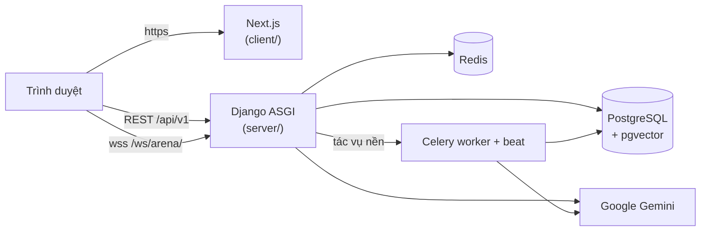

# Gia Sư AI KHTN — Django + Next.js

Nền tảng học **Khoa học Tự nhiên THCS (khối 6–9)** với trợ lý AI (Google Gemini): học sinh hỏi gia sư AI bám sát tài liệu
giáo viên (RAG pgvector), ôn tập bằng quiz / flashcard / sơ đồ tư duy, thi đấu đấu trường realtime và tích lũy XP;
giáo viên quản lý học sinh, ngân hàng câu hỏi, tài liệu tri thức, cấu hình AI và xem báo cáo học tập.

Dựng trên template quản trị Django + Next.js của **ERICSS** (thay cho bản cũ `gia-su-ai-khtn` Express + React — kế hoạch
chuyển đổi: [`docs/plan/migration-from-khtn.md`](docs/plan/migration-from-khtn.md)).

**Tác giả:** ERICSS — GitHub [@nguyenphat006](https://github.com/nguyenphat006)

| Tài liệu | Nội dung |
|---|---|
| [`docs/DEPLOY.md`](docs/DEPLOY.md) | Deploy Render (API) + Vercel (web) + Neon, import dữ liệu bản cũ |
| [`docs/plan/migration-from-khtn.md`](docs/plan/migration-from-khtn.md) | Ánh xạ tính năng bản cũ → bản mới, lỗi bản cũ đã sửa |
| [`server/database.dbml`](server/database.dbml) | Thiết kế CSDL (nguồn chuẩn duy nhất) |
| [`docs/TEMPLATE.md`](docs/TEMPLATE.md) | Tính năng lõi của template, sinh module CRUD |
| [`CLAUDE.md`](CLAUDE.md) · [`AGENTS.md`](AGENTS.md) | Quy chuẩn cho AI agent |

---

## 1. Tính năng

### 1.1 Học sinh — `/learn`
| Phần | Nội dung |
|---|---|
| Gia sư AI | Chat theo phiên, gửi ảnh bài tập, nhập giọng nói; trả lời bám tài liệu giáo viên (RAG), hiển thị công thức LaTeX; bộ lọc nội dung (vi phạm bị chặn + trừ XP) |
| Ôn tập | Quiz trắc nghiệm / tự luận (AI chấm), đề lấy từ ngân hàng, thiếu thì AI sinh bù; flashcard + kiểm tra flashcard; sơ đồ tư duy |
| Đấu trường | Đấu với AI hoặc PvP realtime (thách đấu bạn đang online / ghép trận ngẫu nhiên), nhận xét AI sau trận, bảng vàng |
| Thành tích | XP, chuỗi ngày học, thử thách ngày / tuần, danh hiệu, bảng xếp hạng tuần / tháng / tổng |

### 1.2 Giáo viên / quản trị
| Phân hệ | Route | Nội dung |
|---|---|---|
| Tổng quan | `/` | KPI học sinh hoạt động, câu hỏi gia sư, trận đấu |
| Báo cáo học tập | `/reports` | Tổng quan theo khoảng thời gian / khối / lớp, heatmap giờ học, thống kê và trang chi tiết từng học sinh, nhật ký hỏi đáp AI, lịch sử đấu trường & ôn tập |
| Học vụ | `/academics/{classes,students,teachers}` | Lớp học, học sinh (nhập Excel, mật khẩu ban đầu sinh ngẫu nhiên), giáo viên |
| Ôn tập | `/revision/{questions,flashcards,mindmaps}` | Ngân hàng câu hỏi, flashcard, sơ đồ tư duy; AI soạn nháp |
| Tri thức RAG | `/knowledge` | Tải tài liệu PDF / DOCX / TXT → cắt đoạn → nhúng vector → sinh câu hỏi chờ duyệt |
| Cấu hình AI | `/ai-settings` | Prompt gia sư, model, nhiệt độ, bộ lọc nội dung, số đoạn RAG |
| Lõi template | `/users`, `/settings/modules`, `/audit-logs`, `/profile` | Người dùng, vai trò & ma trận quyền, nhật ký thay đổi dữ liệu |

Vai trò: `ADMIN` (toàn quyền), `TEACHER` (quản lý học vụ / nội dung, xem báo cáo, dùng thử giao diện học sinh), `STUDENT` (chỉ `/learn`).

## 2. Công nghệ

| Tầng | Công nghệ |
|---|---|
| Frontend | Next.js 16 · React 19 · TypeScript · Tailwind CSS 4 · shadcn/ui · TanStack Query 5 · Zustand · next-intl · recharts · react-markdown + KaTeX |
| Backend | Python 3.12 · Django 5.2 LTS · DRF · SimpleJWT · Django Channels (WebSocket) · drf-spectacular · django-pghistory · Celery · google-genai |
| Dữ liệu | PostgreSQL 16 + pgvector (Neon hoặc Docker) · Redis (cache quyền, hàng đợi Celery, channel layer) |
| AI | Gemini (trả lời, sinh câu hỏi / flashcard / sơ đồ, chấm tự luận, bộ lọc nội dung), `gemini-embedding-001` 768 chiều |
| Vận hành | Render (API) + Vercel (web) hoặc Docker Compose (nginx + gunicorn/uvicorn + Next standalone) · GitHub Actions |

## 3. Kiến trúc



- Hợp đồng API: `server/schema.yml` (OpenAPI) → `client/src/types/api.generated.ts` (`npm run gen:api`).
- Server giữ đáp án và chấm điểm (ôn tập, đấu trường); đề gửi học sinh không kèm đáp án.

## 4. Cấu trúc thư mục

```text
server/apps/
  core/ authentication/ audit/ dashboard/   # lõi template
  academics/      # lớp, học sinh, giáo viên, đăng nhập bằng mã HS, import_legacy
  ai/             # client Gemini, prompt, parse JSON giữ LaTeX
  ai_settings/    # cấu hình AI
  knowledge/      # tài liệu nguồn, đoạn tri thức, RAG pgvector, nạp tài liệu (Celery)
  revision/       # câu hỏi, flashcard, sơ đồ; API ôn tập học sinh
  tutor/          # chat gia sư AI
  arena/          # đấu trường: REST đấu AI + WebSocket PvP (consumers.py)
  gamification/   # XP, chuỗi ngày, thử thách, danh hiệu, bảng xếp hạng
  analytics/      # LearningEvents + báo cáo giáo viên
client/src/
  app/(dashboard)/...   # quản trị       app/(student)/learn/...   # học sinh
  modules/...           # logic từng màn hình
```

## 5. Chạy dev

Yêu cầu: Docker Desktop, Python 3.12, Node.js 22+.

```bash
cp server/.env.example server/.env          # điền GEMINI_API_KEY, ADMIN_PASSWORD
cp client/.env.example client/.env.local
docker compose up -d db redis               # Postgres (pgvector) + Redis; đổi cổng bằng DB_HOST_PORT / REDIS_HOST_PORT trong .env gốc

cd server && python -m venv venv && source venv/Scripts/activate && pip install -r requirements.txt
python manage.py bootstrap                  # migrate + vai trò / quyền / cấu hình AI / thử thách + tài khoản admin
python manage.py runserver                  # HTTP + WebSocket (daphne)
celery -A config worker -B --loglevel=info  # nạp tài liệu, nhúng vector, reset XP tuần

cd ../client && npm install && npm run dev  # http://localhost:3000
```

Dữ liệu bản cũ: `python manage.py import_legacy --from-json <dump.json>` hoặc `--source-url <postgres cũ>` (xem `docs/DEPLOY.md`).

## 6. Lệnh thường dùng

| Việc | Lệnh |
|---|---|
| Test backend | `python manage.py test` |
| Sinh lại hợp đồng API | `python manage.py spectacular --file schema.yml --fail-on-warn` → `cd client && npm run gen:api` |
| Kiểm tra frontend | `npx tsc --noEmit` → `npm run lint -- --max-warnings=0` → `npm test` → `npm run i18n:check` → `npm run build` |
| Nhúng vector đoạn tri thức còn thiếu | `python manage.py shell -c "from apps.knowledge.tasks import embed_pending_chunks; embed_pending_chunks()"` |

## 7. Tác giả

**ERICSS** — GitHub [@nguyenphat006](https://github.com/nguyenphat006)

Giấy phép: [MIT](LICENSE).
